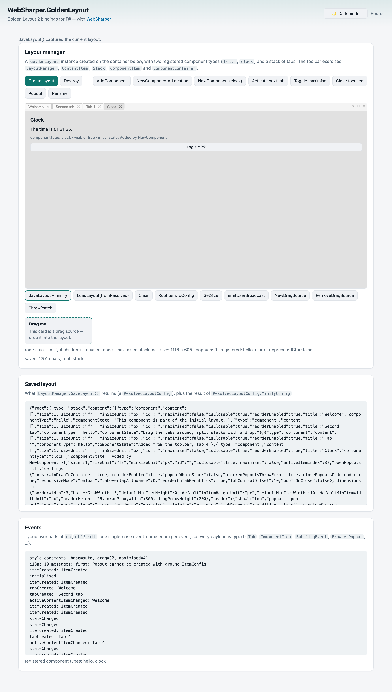

# WebSharper.GoldenLayout

[](https://www.nuget.org/packages/WebSharper.GoldenLayout)

WebSharper bindings for [Golden Layout](https://golden-layout.com/) 2.x (2.6.0+) —
the multi-window layout manager for web apps — for F# and C# WebSharper projects.

The binding consumes the npm package [`golden-layout`](https://www.npmjs.com/package/golden-layout)
as an ES module (`import { GoldenLayout } from "golden-layout"`) and is bundled by
your toolchain (esbuild in the sample); there is no CDN `<script>` tag.

> **Golden Layout 2 is a rewrite.** The v1 API (jQuery based, `Init()`,
> `RegisterComponent(name, fn)`, `Layout(Content = …)`) is gone. This binding
> tracks v2: a `GoldenLayout(container)` constructor that initialises itself,
> `LoadLayout`/`SaveLayout`, `ResolvedLayoutConfig`, component factories, and a
> jQuery-free event system.

This repository contains:

| Project | Purpose |
| --- | --- |
| `WebSharper.GoldenLayout` | The binding: WIG definitions for `GoldenLayout`, `LayoutManager`, `VirtualLayout`, `ContentItem`, `ComponentItem`, `RowOrColumn`, `Stack`, `Header`, `Tab`, `ComponentContainer`, `BrowserPopout`, `DragSource`, `EventEmitter`/`EventHub`, the bubbling event payloads, every `*ItemConfig`/`Resolved*` config, the enums (`ItemType`, `Side`, `LogicalZIndex`, `ResponsiveMode`, `SizeUnit`, `SizeUnitEnum`), and the error classes. |
| `WebSharper.GoldenLayout.Sample` | A WebSharper SPA (esbuild → `dist/`) that drives the whole surface: layout lifecycle, component registration, tabs/stacks, maximise/popout, drag sources, save/load/minify and the typed events. |

## Live demos

**Try it live:** [Open the sample in your browser](https://dotnet-websharper.github.io/goldenlayout/)



The sample doubles as the binding's [test case](#running-the-test-case): it
creates a `GoldenLayout` instance in a container, registers two component
factories, builds a layout from `StackItemConfig`/`ComponentItemConfig`, adds and
removes tabs, maximises and pops out stacks, installs a drag source, saves/loads
the layout (including `MinifyConfig`) and logs every typed event. It is
light-themed by default and has a light/dark theme switcher (persisted in
`localStorage`) that also swaps Golden Layout's own light/dark theme.

- **Sample (this repository):** <https://dotnet-websharper.github.io/goldenlayout/>
- **Source repository:** <https://github.com/dotnet-websharper/GoldenLayout>
- **WebSharper bindings:** <https://websharper.com/bindings>

## Install

```bash
dotnet add package WebSharper.GoldenLayout
```

Or with Paket:

```fsharp
nuget WebSharper.GoldenLayout
```

The package targets `netstandard2.0` and works with WebSharper 10 and 11
projects. It supports Golden Layout `>= 2.6.0 < 3.0.0`; `golden-layout` itself is
pulled from npm (recorded as an `NpmDependencies` entry), so the JS bundle step
must resolve it (WebSharper's SPA/esbuild build does this automatically).

Golden Layout also ships CSS. Link the base stylesheet plus one theme from the
npm package (the sample copies them into `dist/css` and `dist/img` because the
themes reference `../../img/lm_*.png`):

```html
<link rel="stylesheet" href="css/goldenlayout-base.css" />
<link rel="stylesheet" href="css/themes/goldenlayout-light-theme.css" />
```

## Usage

All types live in the `WebSharper.GoldenLayout` namespace.

### Create the layout and register components

```fsharp
open WebSharper
open WebSharper.JavaScript
open WebSharper.GoldenLayout

[<JavaScript>]
let create (container: Dom.Element) =
    let gl = GoldenLayout(container)
    gl.ResizeWithContainerAutomatically <- true

    // Component factories: (container, initial state, isVirtual) -> the bound component.
    gl.RegisterComponentFactoryFunction(
        "hello",
        fun (c: ComponentContainer) (state: obj) (_: bool) ->
            // `c.Element` is the inner element Golden Layout gives you.
            c.Element.InnerHTML <- "<p>" + string state + "</p>"
            box c.Element
    )
```

> Function-typed arguments are emitted twice: as an F#-friendly tuple function
> and as a `System.Func<…>` overload. Pass a plain lambda (`fun c s v -> …`);
> WIG picks the matching overload.

### Layout config

Every config field is a settable property (Golden Layout's config objects are
plain JSON, so nothing is constructor-required), and the concrete item configs
inherit `ItemConfig`, so they can be nested directly:

```fsharp
let layout () =
    LayoutConfig(
        Root =
            StackItemConfig(
                Type = ItemType.Stack,
                Content =
                    [|
                        ComponentItemConfig(
                            Type = ItemType.Component,
                            ComponentType = "hello",
                            Title = "Welcome",
                            ComponentState = box "Hello, Golden Layout!"
                        )
                    |],
                ActiveItemIndex = 0
            ),
        Settings = LayoutSettings(ConstrainDragToContainer = true, ReorderEnabled = true),
        Dimensions = LayoutDimensions(BorderWidth = 3, HeaderHeight = 26),
        Header = LayoutHeader(Show = Union2Of2 Side.Top, Popout = Union2Of2 "pop out")
    )

gl.LoadLayout(layout ())
```

`Union1Of2`/`Union2Of2`/… are needed only for genuine unions such as
`show: false | Side`.

### Events

Every event has its own single-case event-name enum, so all payloads are typed:

```fsharp
gl.On(TabCreatedEventName.TabCreated, fun (tab: Tab) ->
    Console.Log("tab: " + tab.ComponentItem.Title))

gl.On(TitleChangedEventName.TitleChanged, fun (title: string) ->
    Console.Log("renamed to " + title))

gl.On(StackHeaderClickEventName.StackHeaderClick, fun (e: ClickBubblingEvent) ->
    Console.Log("click at " + string e.MouseEvent.ClientX))

gl.On(UserBroadcastEventName.UserBroadcast, fun (args: obj[]) -> ())
```

`on`, `off`, `addEventListener`, `removeEventListener`, `unbind`, `emit`,
`trigger` and `emitBaseBubblingEvent` all have one overload per event.

### Inventory and persistence

```fsharp
let location : Location = gl.AddComponent("hello", box "added at runtime", "New tab")
let item : ComponentItem = gl.NewComponent("hello", box "state", "Another tab")
let focused = gl.FocusedComponentItem           // Optional<ComponentItem>
let root = gl.RootItem                          // Optional<ContentItem>

// Save, then reload: the saved form is a ResolvedLayoutConfig.
let saved = gl.SaveLayout()
let minified = ResolvedLayoutConfig.MinifyConfig(saved)
gl.LoadLayout(LayoutConfig.FromResolved(ResolvedLayoutConfig.UnminifyConfig(minified)))
```

`ComponentItem`, `Stack`, `RowOrColumn` and `ComponentContainer` expose the rest
of the item API (`NewComponent`, `AddChild`, `RemoveChild`, `ToggleMaximise`,
`SetTitle`, `Hide`/`Show`, `Popout`, `ToConfig`, …).

## Notes on the API

- **npm-based.** The binding imports the named exports from `golden-layout`;
  nothing is fetched from a CDN. The `NpmDependencies` range is
  `>= 2.6.0 < 3.0.0`.
- **`GoldenLayout(container)` initialises itself.** If the document is still
  parsing, Golden Layout defers that to `DOMContentLoaded`, so `LoadLayout` has
  to wait for it too (the sample does this with a `document.readyState` check).
- **Config objects are flat with inheritance.** `HeaderedItemConfig`,
  `ComponentItemConfig`, `StackItemConfig` and `RowOrColumnItemConfig` derive
  from `ItemConfig`; the `Resolved*` variants derive from `ResolvedItemConfig`.
  Required-by-upstream fields such as `Type`, `ComponentType` and `Root` are
  documented but not constructor-enforced (the field is named `type`, an F#
  keyword, so a required constructor argument would be called as ``itemType``).
- **`ComponentState` is a JSON value** (`obj` upstream: `JsonValue`), as are a
  handful of explicitly dynamic positions (`ComponentContainer.State`,
  `EventEmitter` broadcast arguments). `ComponentType` is typed as `string` —
  the registered type name, which is what `RegisterComponent*` accepts.
- **Event payloads are typed**, and the bubbling events (`BubblingEvent`,
  `ClickBubblingEvent`, `TouchStartBubblingEvent`) are declared as classes.
  Core has no `TouchEvent`, so `TouchStartBubblingEvent.TouchEvent` is a
  `Dom.Event`.
- **Pointer events.** Core has no `PointerEvent`, so the binding declares a
  minimal `WebSharper.GoldenLayout.PointerEvent` (inheriting `Dom.MouseEvent`,
  plus `PointerId`/`PointerType`/`IsPrimary`) for the `drag`/`dragStop` events.
- **DOM elements are `Dom.Element`** (not `Html5.HTMLElement`), so they
  interoperate with `Document.GetElementById` and `Doc.Run`.
- **`ComponentContainer.Virtual`/`.Component` are only readable after the
  factory returns** (they read Golden Layout's bound component).
- **Not bound:** the `LogicalZIndexToDefaultMap` constant, the internal
  `I18nStringId` const enum, and the pure `*createCopy`/`*resolve` namespace
  helpers of the config types. `I18nStrings.IdCount`/`Strings`/`CheckInitialise`,
  `StyleConstants`, `ItemConfig.IsStack`/`IsRow`/…, `ResolvedItemConfig.IsComponentItem`/`IsStackItem`
  and `JsonValue.IsJson`/`IsJsonObject` are available.
- **`ContentItem.isStack(item)` is not bound** because its CLR name would
  collide with the `ContentItem.IsStack` property; use `item.IsStack` or
  `ItemConfig.IsStack(config)` instead.
- **v1 → v2 migration.** Old code using `ItemFactory`, `RegisterComponent` with
  a `(container, state)` function, `Init()`, `Layout(Content = …)`,
  `JQuery.Of "#container"` or `GeneralItemConfig` must move to the v2 API above.

## Running the test case

The sample is a static SPA. Building it runs `npm install` and esbuild and emits
`dist/` at the repository root:

```bash
dotnet build WebSharper.GoldenLayout.Sample/WebSharper.GoldenLayout.Sample.fsproj -c Release
dotnet serve -d dist -p 8080
```

`dotnet serve` comes from the [`dotnet-serve`](https://github.com/dotnet-serve/dotnet-serve)
tool; install it once with `dotnet tool install -g dotnet-serve`.

Open <http://localhost:8080/>. Golden Layout (JS, CSS and icons) is fully
bundled/copied, so no network access is needed. The toolbar drives the whole
binding — use it to verify a change end to end.

## Building from source

### Prerequisites

- [.NET SDK 10](https://dotnet.microsoft.com/download) or later (the WS11
  compiler needs .NET 11).
- [Node.js](https://nodejs.org/) (for the sample's esbuild step).
- [Paket](https://fsprojects.github.io/Paket/) as a local dotnet tool (configured
  in `.config/dotnet-tools.json`).

### Restore and build

```bash
dotnet tool restore
dotnet paket restore
dotnet build WebSharper.GoldenLayout.sln -c Release
```

The binding targets `netstandard2.0`; the sample is a static bundle.

### Pack the NuGet package

```bash
./build WS-Package
# or, after a Release build:
dotnet paket pack ./out
```

## Deployment

Pushing to the default branch triggers `.github/workflows/ghpages.yml`, which
builds the sample in Release on .NET 11 and publishes `dist/` to the `gh-pages`
branch via GitHub Pages.

## Repository layout

```
WebSharper.GoldenLayout/              # the binding (WIG definitions)
  Main.fs
WebSharper.GoldenLayout.Sample/       # static SPA demo / test case
  Client.fs
  index.html
  site.css
  esbuild.config.mjs
  wsconfig.json
docs/
  sample.png                          # screenshot of the running sample
nuget/                                # Paket pack template
.github/workflows/ghpages.yml         # build + deploy the sample
```

## License

Apache 2.0 — see [LICENSE.md](LICENSE.md).